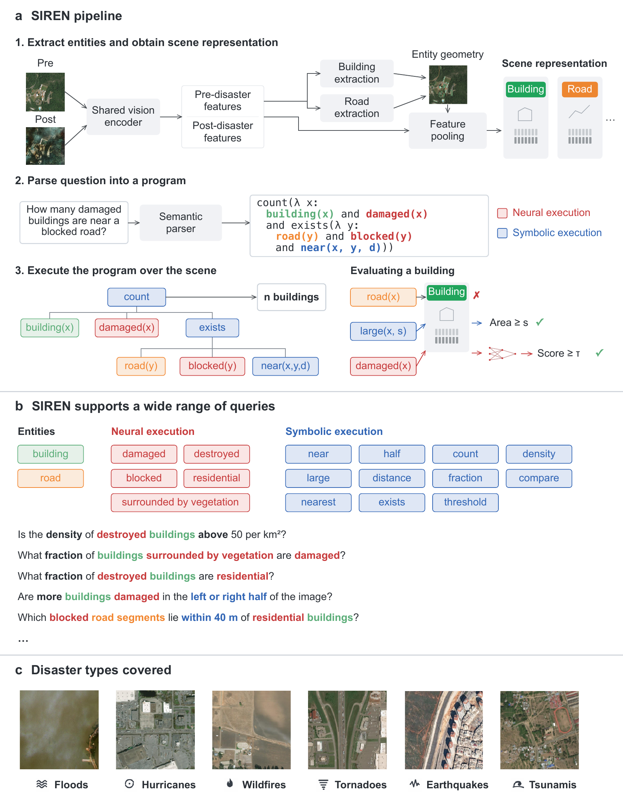

# SIREN

Code for **Neurosymbolic disaster assessment from satellite imagery**.

After disasters, responders use satellite imagery to quickly assess damage and guide response at scale. As priorities evolve, they need timely answers about affected areas, such as how many homes were destroyed or the density of blocked roads. Yet answering these questions accurately and efficiently remains challenging. Here, we introduce SIREN, a neurosymbolic framework that predicts properties of entities such as buildings and roads from satellite imagery and combines these predictions through explicit reasoning to answer diverse questions. Across 15 disasters spanning six types, SIREN estimates counts more accurately than state-of-the-art remote-sensing foundation models and frontier vision-language models, reducing error by 7.7–28.9% on questions that combine multiple conditions. By reusing intermediate results across questions, SIREN reduces model computation by 4.4–27.7-fold compared with baselines. SIREN also learns effectively from limited annotations and transfers to three disasters without event-specific calibration. Ultimately, SIREN provides an accurate, efficient and flexible approach to disaster assessment.

This repository includes a notebook with a real disaster image pair and code for training and evaluation. Trained models and data are downloaded separately (below).



## Install

Use Python 3.13 or 3.14 (the tested versions) in a new environment. From the repository folder:

```sh
python3.13 -m venv .venv
source .venv/bin/activate
python -m pip install -e '.[notebook,test]'
python -m pip install -r requirements-model.txt
```

## Download models and data

Download the models, data and `SHA256SUMS` from the [v1.0.0 release](https://github.com/arushig100/SIREN/releases/tag/v1.0.0),
then check and extract them in this folder:

```sh
shasum -a 256 -c --ignore-missing SHA256SUMS   # Linux: sha256sum -c --ignore-missing SHA256SUMS
tar -xzf siren-models.tar.gz
tar -xzf siren-data.tar.gz
```

- **[siren-models.tar.gz](https://github.com/arushig100/SIREN/releases/download/v1.0.0/siren-models.tar.gz)** provides the five trained SIREN model files and split metadata under `assets/`.
- **[siren-data.tar.gz](https://github.com/arushig100/SIREN/releases/download/v1.0.0/siren-data.tar.gz)** provides the labels, entity annotations, reference counts, saved predictions and training subsets under `data/`.
- **[siren-training-initialization.tar.gz](https://github.com/arushig100/SIREN/releases/download/v1.0.0/siren-training-initialization.tar.gz)** provides the initial building detector, needed only when retraining entity extraction.

[SHA256SUMS](https://github.com/arushig100/SIREN/releases/download/v1.0.0/SHA256SUMS) lists a SHA-256 hash for each archive.

## Run the example

```sh
jupyter lab demo.ipynb
```

Run the cells in order. The notebook runs SIREN on the included Hurricane Michael image pair
and shows how query programs calculate answers. It needs `siren-models.tar.gz`, but no API key,
`siren-data.tar.gz` or DisasterM3 download.

## Ask a question

To enable natural-language queries, install the language extra and set the selected provider's
API key (`ANTHROPIC_API_KEY` for this example). Run the notebook first to save the scene record
used below, and choose output files that do not exist yet:

```sh
python -m pip install -e '.[language]'
python -m siren.language --provider anthropic --model claude-sonnet-4-6 \
  --question 'What fraction of buildings are damaged?' --output outputs/program.json
python -m siren.language --compiled outputs/program.json \
  --scene outputs/demo/hurricane_michael_00000012_disaster.json --output outputs/answer.json
```

Density, image-half and distance programs also need `--context`, a JSON file such as
`{"image_width_px": 1024, "valid_area_px": 1048576, "pixel_size_m": 0.8}`. Other providers
work with `--provider openai` or an OpenAI-compatible `--base-url`.

## Training and evaluation

[EXPERIMENTS.md](EXPERIMENTS.md) gives the commands to train and evaluate SIREN and the
baselines, and to recompute the reported metrics from the saved predictions. Training needs
the DisasterM3 images and road masks; inference needs the images. The export uses a Unix file
lock, so it runs on Linux or macOS.

## Code layout

| Folder | Purpose |
| --- | --- |
| `src/siren/inference/` | Run SIREN on paired images and export scored entities |
| `src/siren/perception/` | Shared encoder, entity extraction and training |
| `src/siren/programs/` | Define, validate and execute query programs, including spatial relationships |
| `src/siren/language/` | Translate natural-language questions into programs |
| `src/siren/concepts/` | Visual classifiers, training and calibration |
| `src/siren/segmentation/` | Building and road model components |
| `src/siren/baselines/` | Remote-sensing count baselines |
| `src/siren/evaluation/` | Count scoring and experiment workflows |

Shared thresholds and geometry definitions are in `src/siren/settings.py`.
Run `python -m pytest -q` to check the code.

## License

The SIREN code uses the [MIT License](LICENSE). Data and pretrained weights have separate terms:

- [DisasterM3 images and annotations](https://huggingface.co/datasets/Kingdrone-Junjue/DisasterM3#license): CC BY-NC-SA 4.0 (noncommercial).
- [OpenStreetMap-derived data](https://www.openstreetmap.org/copyright): © OpenStreetMap contributors, ODbL 1.0.
- [FEMA USA Structures](https://gis-fema.hub.arcgis.com/pages/usa-structures) and the [USACE National Structure Inventory](https://www.hec.usace.army.mil/confluence/nsi/technicalreferences/2022/technical-documentation): used for residential training labels.
- External-event reference counts: CAL FIRE DINS records ([Eaton](https://data.lacounty.gov/datasets/CALFIRE-Forestry::dins-2025-eaton-public-view/about), [Palisades](https://data.lacounty.gov/datasets/CALFIRE-Forestry::dins-2025-palisades-public-view/about)) and [DesignSafe PRJ-5700](https://doi.org/10.17603/ds2-c1g8-qy41) (Hurricane Ian, ODC-BY 1.0).
- [Satlas pretrained weights](https://github.com/allenai/satlaspretrain_models#available-pretrained-models): ODC-BY 1.0. SIREN checkpoints are fine-tuned from these weights. The Satlas software package uses Apache 2.0.

These source terms also apply where their material is included in this repository, including the
example images in `examples/` and the image panels in `figures/overview.png` (DisasterM3,
CC BY-NC-SA 4.0), and in the model and data archives. `assets/README.md`,
`assets/README_training_initialization.md` and `data/README.md` give the terms for each archive. The code license does not replace them.

## Citation

```bibtex
@misc{gupta2026neurosymbolic,
  title   = {Neurosymbolic disaster assessment from satellite imagery},
  author  = {Gupta, Arushi and Huang, Tianyuan and Wang, Zhecheng and Hsu, Joy and Wu, Jiajun},
  note    = {Under review},
  year    = {2026}
}
```
